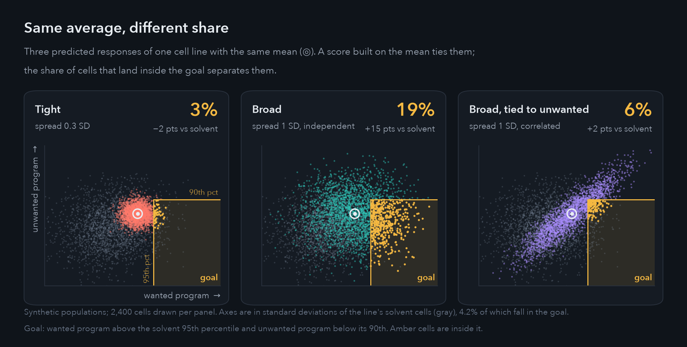
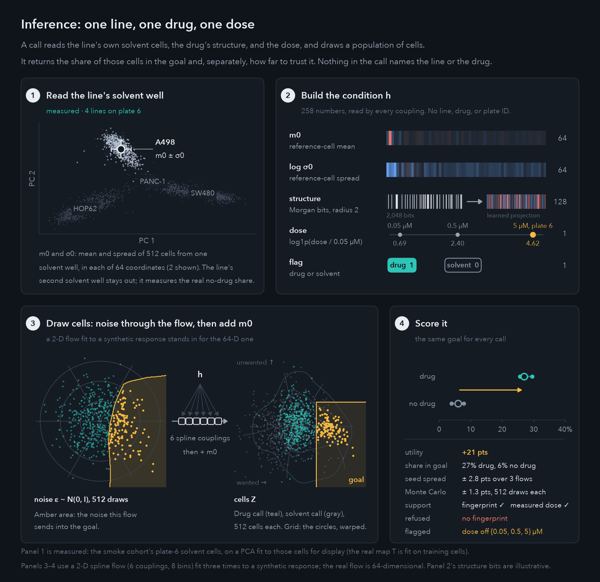
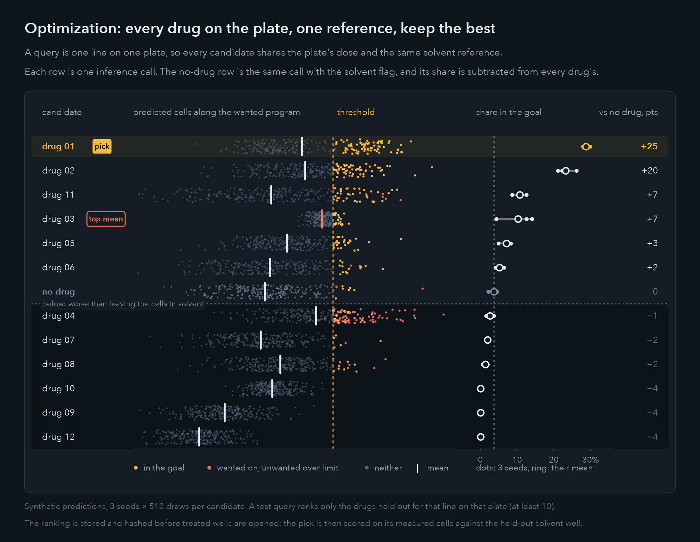
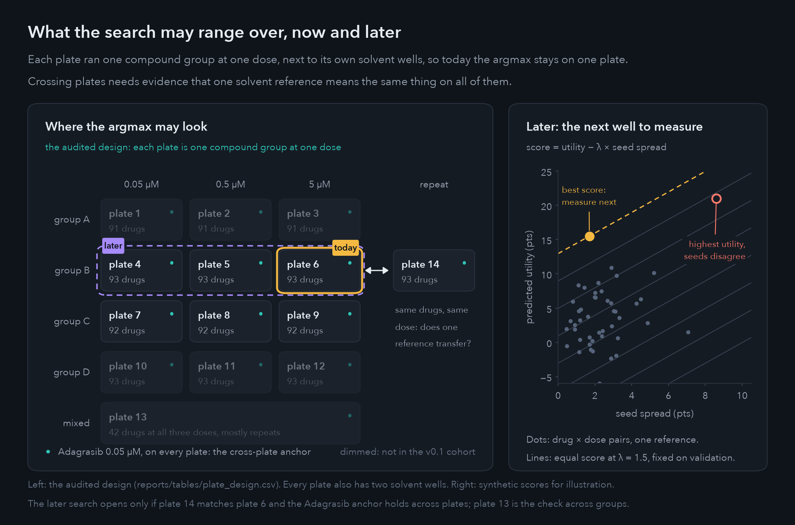

# expression

Which genes a cell is using at a given moment, its *expression state*, largely decides what it does: divide, rest, repair damage, or respond to stress. Many diseases involve cells stuck in the wrong state. Cancer cells keep their division programs running and ignore the damage signals that should stop them; in chronic inflammation or fibrosis, cells stay locked in a harmful program. Seen at the level of single cells, treatment means moving cells into a better state. Small-molecule drugs are the most common way to do that; gene editing, engineered proteins, and combinations are others.

The target is rarely one gene. It is usually a wanted program switched on, such as the DNA-damage response that stops a cancer cell from dividing, while an unwanted one stays off, such as a general stress response that any toxic drug can trigger. Cells of the same line also respond unevenly: one drug moves every cell a little, another moves a fraction of the cells all the way. When the goal is a state, what counts is the share of cells that reach it, not how far the average cell moved.

This project ranks small-molecule drugs by that share. For one cancer cell line, it predicts the whole population of treated cells from the line's own untreated cells, the drug's chemical structure, and the dose, then counts the predicted cells that land in the goal. The data is [Tahoe-100M](https://huggingface.co/datasets/tahoebio/Tahoe-100M): 50 cancer cell lines grown together in each well, 379 drugs at three doses, and 95.6 million cells whose RNA was counted one cell at a time, 24 hours after treatment. The test hides drug–line pairs, ranks them, and only then opens the hidden wells.



A score built on the average cannot tell these apart, so the model predicts populations and every ranking is by share.

The search stays inside one plate. Each plate ran one group of about 93 drugs at one dose (plate 13 mixes them), next to two wells of solvent alone, so only drugs on the same plate share a dose and a no-drug reference. A query is one cell line on one plate, with one goal.

In the figures, only the solvent cells (inference, panel 1) and the plate layout are measured. Every drug response is synthetic: no model is fit yet, and treated cells stay unread until the splits and goals are frozen.

## Inference



A call takes the line's cells from one solvent well, a structure (SMILES), and a dose. A map `T`, fit on training cells and then frozen, puts every cell in the same 64 coordinates: normalize to 10,000 counts, log1p, 2,000 variable genes, PCA, scaling.

1. **Read the solvent well.** `m0` and `σ0` are the mean and spread of the reference cells in each coordinate. The line's other solvent well never enters a call; it measures the real no-drug share.
2. **Build `h`.** `m0`, `log σ0`, a 2,048-bit Morgan fingerprint (radius 2) projected to 128 numbers, `log1p(dose / 0.05 µM)`, and a drug/solvent flag: 258 numbers. There are no IDs, so a line is known only by its cells and a drug only by its structure.
3. **Draw cells.** 512 standard-normal draws pass through a rational-quadratic spline flow (6 couplings, 8 bins, 2×256 conditioners, 1.84M parameters), and every coupling reads `h`. The output is a residual `R`; the cells are `Z = R + m0`.
4. **Score.** The goal tests each drawn cell: the wanted gene module above a threshold and the unwanted one under a limit. Both cutoffs come from training solvent cells and are fixed before any test outcome is seen. Utility is the drug's share minus the share from the same call with the solvent flag.

The share, the spread across three separately trained flows, the Monte Carlo error, and the support flags come back as separate numbers. A structure with no fingerprint is refused, and a dose other than 0.05, 0.5, or 5 µM is flagged as unevaluated. If the 64 coordinates distort goal shares on validation (median error above 0.05, or rank correlation below 0.8), the flow models the module scores directly and the call is otherwise unchanged.

## Optimization



Optimization is that call repeated across a plate: one call per candidate, all with the same reference well and the plate's dose, plus one call with the solvent flag. Candidates are ranked by utility. Doing nothing is itself a candidate, with utility zero, so a drug that scores below zero loses to leaving the cells alone. A penalty on seed spread is optional; if used, it is fixed on validation. Comparisons across doses, compound groups, or unseen lines are refused.

Each test query ranks only the drugs withheld from that line on that plate: about 14, never fewer than 10, with every dose and repeat of a withheld pair withheld too. Rankings are written and hashed before any treated well is read. Then the top pick is scored on its measured cells against the line's held-out solvent well. The flow passes if that observed top-1 utility beats the strongest validation-selected baseline by at least 5 percentage points, with a paired interval, the same direction in all three seeds, and no material rise in the unwanted share. The baselines see the same reference cells and structures: resampled solvent cells, one shared drug–dose shift, a ridge mean with empirical residuals, a conditional Gaussian, a four-component mixture, and nearest-chemical-neighbor transfer for unseen compounds.

This measures ranking within the documented assay. It does not support choosing between drugs that never shared a plate.

### Across plates, later



Joint drug and dose search is not evaluated today, because each dose sits on its own plate beside its own solvent wells. It opens only if one reference holds across plates, which two repeats can test: plate 14 repeats plate 6 (the same drugs at 5 µM), and Adagrasib at 0.05 µM is on all 14 plates. If both checks pass, the same loop runs over a group's measured drug × dose grid (279 pairs for group B) against one reference, and it picks the next well to measure by utility − λ × seed spread, with λ fixed on validation. Plate 13, which mixes groups and doses, is the check before searching across groups. The penalty is a heuristic, not a calibrated bound; the repeat plates show whether it helps.

## Training

```mermaid
flowchart LR
  subgraph stored ["Data on disk"]
    direction TB
    Split[("Frozen split<br/>held-out pairs and plate 14 stay out")] --> Cells[("Training cells")]
  end
  subgraph once ["Fit once, then frozen"]
    direction TB
    Fit["Fit T<br/>training cells only"] --> Map[["T<br/>scale, log1p, 2,000 genes, 64 PCs"]]
  end
  subgraph draw ["One batch, drawn from the training cells"]
    direction LR
    Batch[/"1,024 cells, through T<br/>a condition, then a well, then cells"/]
    Resid[/"Residual R = Z − m0<br/>m0 from the reference well"/]
    Cond[/"Condition h<br/>m0, log σ0, fingerprint, dose, flag"/]
    Chem[("Structure and dose")]
    Batch --> Resid
    Batch --> Cond
    Chem -->|fingerprint, dose| Cond
  end
  subgraph loop ["Every update"]
    direction TB
    Flow[["Spline flow<br/>6 couplings, 8 bins, 1.84M weights"]]
    Loss["Loss<br/>−log p(R | h)"]
    Update["AdamW step<br/>3e-4, weight decay 1e-4, clip 1.0"]
    Flow --> Loss --> Update
    Update -.->|new weights| Flow
  end
  subgraph finish ["Handed to inference"]
    direction TB
    Keep["Keep the best checkpoint<br/>validation energy score"] --> Done(["Three seeds,<br/>frozen with T"])
  end
  Cells --> Fit
  Map --> Batch
  Resid --> Loss
  Cond --> Loss
  Update --> Keep

  classDef data fill:#e7f2f8,stroke:#2c6e8a,color:#143044
  classDef sample fill:#efe9fe,stroke:#6d28d9,color:#2e1065
  classDef model fill:#f8efdd,stroke:#a56b1f,color:#3d2a0a
  classDef step fill:#e5f6f3,stroke:#0f766e,color:#134e4a
  classDef result fill:#e5f6e8,stroke:#157347,color:#0d3320
  class Split,Cells,Chem data
  class Batch,Resid,Cond sample
  class Map,Flow model
  class Fit,Loss,Update,Keep step
  class Done result
  style stored fill:#f7fafc,stroke:#c5d0dc
  style once fill:#fbf8f2,stroke:#e2d3b3
  style draw fill:#f8f6fc,stroke:#d9d0ea
  style loop fill:#f3faf7,stroke:#b7ddd2
  style finish fill:#f4faf6,stroke:#b7ddc4
```



Each group is a stage, and the shape says what a box is. Cylinders are data kept on disk, slanted boxes are a draw from it, double boxes are fitted models, plain boxes are steps, and the rounded box is what training hands to inference. `T` is fit once and then frozen. The dashed arrow is the only thing an update changes: the flow's weights. Each step draws a new batch the same way, a condition, then a well, then its cells, so a crowded well weighs the same as a sparse one.

## Status

| | |
| --- | --- |
| Done | Data and design audits, a verified cell-location map, the smoke cohort (plate 6, 4 lines, 12 drugs, 10,240 cells) |
| In progress | Prototype cohort: 12 lines, plates 4–9 and 14, about 2.4M cells |
| Next | Frozen splits, goals, and `T`, then the representation gate |
| Specified, not built | Baselines, flow, plate search, cross-plate search |

## Run

```bash
./scripts/setup.sh                                        # direnv, HF_TOKEN in .env, uv sync
uv run pytest
uv run cellresponse audit --config configs/audit.yaml     # writes reports/
uv run cellresponse prepare --config configs/smoke.yaml   # smoke cohort, about 1 GB
uv run python scripts/readme_figures.py                   # these figures; needs the smoke cohort
```

The full contract is in [`cellular_response_prototype_brief.md`](cellular_response_prototype_brief.md), departures from it in [`DECISIONS.md`](DECISIONS.md), milestones and gates in [`ROADMAP.md`](ROADMAP.md), and the audits in [`reports/`](reports/).
